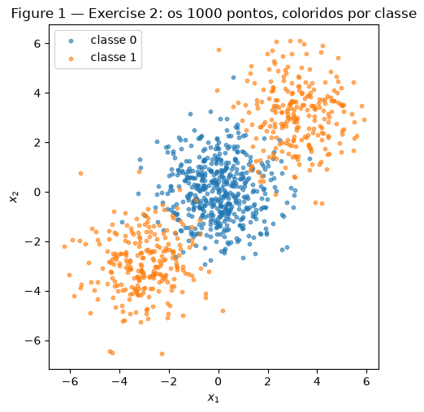
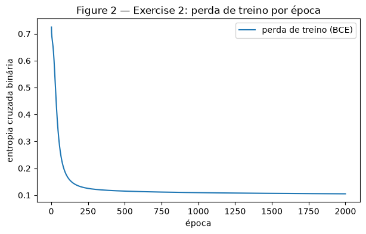
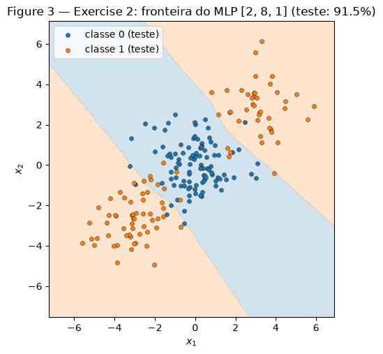
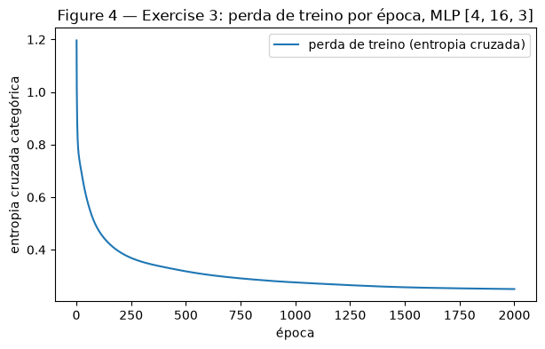
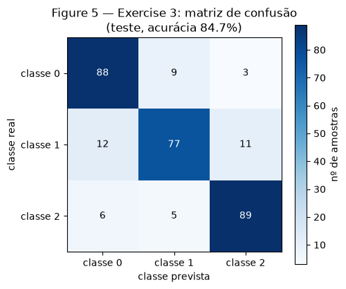
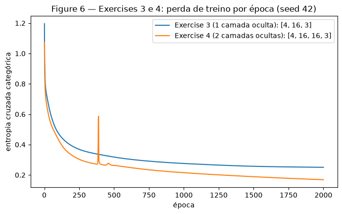

# Exercise 3 — MLP

Neste exercício implementei um MLP do zero em NumPy. O Exercise 1 é uma etapa de backpropagation feita à
mão. O Exercise 2 é um problema binário que uma reta não resolve. O Exercise 3 usa a mesma rede em um
problema com três classes. O Exercise 4 testa se uma segunda camada oculta ajuda.

**Como fiz.**

- O MLP está em [`code/mlp.py`](code/mlp.py), em uma classe `MLP`. Os tamanhos das camadas são um argumento
  (por exemplo `[2, 8, 1]`). A classe tem as ativações, a perda, o forward, o backward com todos os gradientes
  escritos à mão e o update por gradiente descendente. Não usei nenhuma biblioteca de redes neurais.
- As camadas ocultas usam tanh. A saída usa sigmoide no caso binário e softmax no caso multiclasse. A perda é a
  entropia cruzada (binária ou categórica). Nos dois casos o gradiente na saída é
  $\partial L / \partial \mathbf{u} = (\hat{\mathbf{y}} - \mathbf{y})/N$, então o mesmo código de backward serve
  para os Exercises 2, 3 e 4 sem nenhuma alteração. Só mudam os argumentos.
- Os pesos começam com $\mathcal{N}(0,\ 1/n_{\text{entradas}})$ e os vieses em zero. O treino é em lote
  completo (todas as amostras de treino a cada época).
- O scikit-learn foi usado só para gerar os dados, dividir treino e teste, calcular a matriz de confusão e
  rodar as regressões logísticas de baseline, como o enunciado permite.
- Cada script começa com `rng = np.random.default_rng(42)`, e esse `rng` inicializa os pesos da rede. No
  Exercise 4, onde o enunciado pede pelo menos 3 seeds, cada execução usa `default_rng(seed)` com
  seed 42, 43 e 44. A execução com seed 42 é a mesma do Exercise 3.

Também deixei tudo em um notebook com as saídas: [`code/mlp_notebook.ipynb`](code/mlp_notebook.ipynb). Os
números dele são os mesmos deste relatório.

```python
--8<-- "docs/exercises/mlp/code/mlp.py"
```

---

## Exercise 1

**One Step of Backpropagation, by Hand.** Rede 2-2-1 com tanh nas duas camadas e perda $L = (y - \hat y)^2$ para uma amostra. Valores dados:
$\mathbf{x} = [0.5,\ -0.2]$, $y = 1$, $W^{(1)} = \begin{bmatrix}0.3 & -0.1\\ 0.2 & 0.4\end{bmatrix}$,
$\mathbf{b}^{(1)} = [0.1,\ -0.2]$, $W^{(2)} = [0.5,\ -0.3]$, $b^{(2)} = 0.2$ e $\eta = 0.3$. Fiz as contas à mão
e mantive 6 casas nos cálculos intermediários; os resultados estão com 4 casas.

### A — Forward pass

**Pré-ativações da camada oculta**, $\mathbf{z}^{(1)} = W^{(1)}\mathbf{x} + \mathbf{b}^{(1)}$:

$$z^{(1)}_1 = 0.3(0.5) + (-0.1)(-0.2) + 0.1 = 0.15 + 0.02 + 0.1 = 0.2700$$

$$z^{(1)}_2 = 0.2(0.5) + 0.4(-0.2) - 0.2 = 0.10 - 0.08 - 0.2 = -0.1800$$

**Ativações da camada oculta**, $\mathbf{h}^{(1)} = \tanh(\mathbf{z}^{(1)})$:

$$h^{(1)}_1 = \tanh(0.27) = 0.2636, \qquad h^{(1)}_2 = \tanh(-0.18) = -0.1781$$

**Pré-ativação da saída**, $u^{(2)} = W^{(2)}\mathbf{h}^{(1)} + b^{(2)}$:

$$u^{(2)} = 0.5(0.263625) + (-0.3)(-0.178081) + 0.2 = 0.131813 + 0.053424 + 0.2 = 0.3852$$

**Saída e perda:**

$$\hat y = \tanh(0.385237) = 0.3672, \qquad L = (1 - 0.367247)^2 = (0.632753)^2 = 0.4004$$

### B — Backward pass

Comecei por $\partial L / \partial \hat y$ e fui aplicando a regra da cadeia para trás. A derivada da tanh é
$1 - \tanh^2(u)$.

**1. Saída.**

$$\frac{\partial L}{\partial \hat y} = -2(y - \hat y) = -2(0.632753) = -1.2655$$

$$\frac{\partial \hat y}{\partial u^{(2)}} = 1 - \hat y^2 = 1 - 0.367247^2 = 0.8651$$

$$\frac{\partial L}{\partial u^{(2)}} = \frac{\partial L}{\partial \hat y}\cdot\frac{\partial \hat y}{\partial u^{(2)}}
= -1.265507 \times 0.865130 = -1.0948$$

**2. Camada de saída.** Como $u^{(2)} = W^{(2)}\mathbf{h}^{(1)} + b^{(2)}$:

$$\frac{\partial L}{\partial W^{(2)}} = \frac{\partial L}{\partial u^{(2)}}\,\mathbf{h}^{(1)}
= -1.094828 \times [0.263625,\ -0.178081] = [-0.2886,\ 0.1950]$$

$$\frac{\partial L}{\partial b^{(2)}} = \frac{\partial L}{\partial u^{(2)}} = -1.0948$$

**3. De volta para a camada oculta.**

$$\frac{\partial L}{\partial \mathbf{h}^{(1)}} = \frac{\partial L}{\partial u^{(2)}}\,W^{(2)}
= -1.094828 \times [0.5,\ -0.3] = [-0.5474,\ 0.3284]$$

$$1 - (\mathbf{h}^{(1)})^2 = [1 - 0.263625^2,\ 1 - 0.178081^2] = [0.9305,\ 0.9683]$$

$$\frac{\partial L}{\partial \mathbf{z}^{(1)}} = \frac{\partial L}{\partial \mathbf{h}^{(1)}} \odot \left(1 - (\mathbf{h}^{(1)})^2\right)
= [-0.547414 \times 0.930502,\ 0.328448 \times 0.968287] = [-0.5094,\ 0.3180]$$

**4. Camada oculta.** Como $\mathbf{z}^{(1)} = W^{(1)}\mathbf{x} + \mathbf{b}^{(1)}$, cada linha do gradiente de
$W^{(1)}$ é o $\partial L/\partial z_j$ daquele neurônio vezes $\mathbf{x}$:

$$\frac{\partial L}{\partial W^{(1)}} = \frac{\partial L}{\partial \mathbf{z}^{(1)}}\,\mathbf{x}^\top
= \begin{bmatrix}-0.509370(0.5) & -0.509370(-0.2)\\ 0.318032(0.5) & 0.318032(-0.2)\end{bmatrix}
= \begin{bmatrix}-0.2547 & 0.1019\\ 0.1590 & -0.0636\end{bmatrix}$$

$$\frac{\partial L}{\partial \mathbf{b}^{(1)}} = \frac{\partial L}{\partial \mathbf{z}^{(1)}} = [-0.5094,\ 0.3180]$$

### C — Parameter update

Com $p \leftarrow p - \eta\,\partial L/\partial p$ e $\eta = 0.3$:

| parâmetro | antes | gradiente | depois |
|---|---|---|---|
| $W^{(2)}_{1}$ | 0.5 | −0.2886 | 0.5 + 0.3(0.288624) = **0.5866** |
| $W^{(2)}_{2}$ | −0.3 | 0.1950 | −0.3 − 0.3(0.194968) = **−0.3585** |
| $b^{(2)}$ | 0.2 | −1.0948 | 0.2 + 0.3(1.094828) = **0.5284** |
| $W^{(1)}_{11}$ | 0.3 | −0.2547 | 0.3 + 0.3(0.254685) = **0.3764** |
| $W^{(1)}_{12}$ | −0.1 | 0.1019 | −0.1 − 0.3(0.101874) = **−0.1306** |
| $W^{(1)}_{21}$ | 0.2 | 0.1590 | 0.2 − 0.3(0.159016) = **0.1523** |
| $W^{(1)}_{22}$ | 0.4 | −0.0636 | 0.4 + 0.3(0.063606) = **0.4191** |
| $b^{(1)}_{1}$ | 0.1 | −0.5094 | 0.1 + 0.3(0.509370) = **0.2528** |
| $b^{(1)}_{2}$ | −0.2 | 0.3180 | −0.2 − 0.3(0.318032) = **−0.2954** |

O enunciado fala em oito parâmetros, mas contando cada número são nove: $W^{(2)}$ tem dois, $b^{(2)}$ um,
$W^{(1)}$ quatro e $\mathbf{b}^{(1)}$ dois. Atualizei todos.

**A perda sobe ou desce no próximo forward?** Desce. Todos os parâmetros andaram no sentido contrário ao
gradiente, e para um passo não muito grande isso diminui a perda (em primeira ordem,
$\Delta L \approx -\eta\,\lVert\nabla L\rVert^2 < 0$). Também dá para ver pelo sinal: $\partial L/\partial u^{(2)} < 0$
quer dizer que aumentar $u^{(2)}$ aproxima $\hat y$ de $y = 1$, e a atualização aumentou $u^{(2)}$: subiu $b^{(2)}$
e $W^{(2)}_1$, e deixou $W^{(2)}_2$ mais negativo, o que também soma porque $h^{(1)}_2 < 0$. Refazendo o forward com os novos parâmetros, $u^{(2)}$ passa de 0.3852 para 0.8896,
$\hat y$ passa de 0.3672 para 0.7112 e a perda cai de **0.4004 para 0.0834**.

---

## Exercise 2

**Binary Classification a Straight Line Cannot Do.** Script do exercício (usa a classe `MLP` mostrada acima):

```python
--8<-- "docs/exercises/mlp/code/ex2_binary.py"
```

### A — Generate the data

Usei `make_blobs` com centros em (0, 0), (3, 3) e (−3, −3), 500 pontos no centro da origem e 250 em cada um dos
outros, `cluster_std = 1.2` e `random_state = 42`. A classe 0 é o cluster da origem e a classe 1 são os dois
clusters de fora, então as duas classes têm 500 pontos. Dividi em 80% treino (800 pontos) e 20% teste
(200 pontos), com `stratify=y` e `random_state=42`. O teste ficou com 100 pontos de cada classe.



### B — Establish the baseline

Treinei uma regressão logística no conjunto de treino. A acurácia no teste foi **47.50%**, abaixo dos 50% de
um chute. Os coeficientes saíram praticamente nulos: $\mathbf{w} = [0.0296,\ 0.0015]$ e intercepto $-0.0031$.
Com pesos tão pequenos a probabilidade prevista fica perto de 0.5 em todo o gráfico, e o modelo previu
classe 1 para 44.5% dos pontos de teste.

### C — Implement the MLP

**Arquitetura e treino.** Rede `[2, 8, 1]`: 2 entradas, uma camada oculta com 8 neurônios tanh e 1 saída
sigmoide, com 33 parâmetros. Usei entropia cruzada binária como perda, taxa de aprendizado $\eta = 0.5$ e
**2000 épocas** em lote completo.

**Gradientes.** Com $\hat y = \sigma(u)$ e $L = -[y\log\hat y + (1-y)\log(1-\hat y)]$, a derivada da sigmoide
$\hat y(1 - \hat y)$ cancela com o denominador da perda e sobra $\partial L/\partial u = \hat y - y$. Na média
sobre $N$ amostras, o delta da saída é $\delta = (\hat{\mathbf{y}} - \mathbf{y})/N$. A partir dele, para cada
camada (da última para a primeira):

$$\frac{\partial L}{\partial W} = \delta^\top \mathbf{a}_{\text{anterior}}, \qquad
\frac{\partial L}{\partial \mathbf{b}} = \textstyle\sum \delta, \qquad
\delta_{\text{anterior}} = (\delta\, W) \odot (1 - \mathbf{a}_{\text{anterior}}^2)$$

e o update é $W \leftarrow W - \eta\,\partial L/\partial W$, $\mathbf{b} \leftarrow \mathbf{b} - \eta\,\partial L/\partial \mathbf{b}$.

**Resultado.** A perda de treino caiu de 0.7248 na primeira época para 0.1051 na última. A acurácia foi
96.75% no treino e **91.50% no teste**.





### D — Analysis

**Por que a reta fica abaixo de 50% e o MLP passa de 90%?** Pela Figure 1, a classe 1 está dos dois lados da
classe 0, ao longo da diagonal: um cluster em (3, 3) e outro em (−3, −3). Uma reta divide o plano em só dois
semiplanos, então ela consegue no máximo deixar a classe 0 junto com um dos clusters de fora. Além disso, os
dados são simétricos em relação à origem: trocar $\mathbf{x}$ por $-\mathbf{x}$ não muda as classes. Qualquer
inclinação que ajuda a acertar o cluster de (3, 3) atrapalha na mesma medida no de (−3, −3), e a perda da
regressão logística fica mínima com os pesos perto de zero. Foi o que aconteceu: $\mathbf{w} \approx [0.03,\ 0.00]$,
probabilidade perto de 0.5 em todo lugar e uma reta quase vertical passando pelo meio, que divide as duas
classes ao meio. Isso dá cerca de 50%, e os 47.50% são esse chute mais a variação de uma amostra de teste de
200 pontos.

**Forma da região da classe 1.** Na Figure 3, a rede classifica como classe 0 uma faixa na diagonal que vai do
canto de cima à esquerda até o canto de baixo à direita, passando pela origem, e como classe 1 as duas regiões
fora dessa faixa: uma acima e à direita e outra abaixo e à esquerda. A região da classe 1 tem 56.5% da grade e
fica dos dois lados da reta $x_1 + x_2 = 0$ (53.1% da grade acima dela e 59.6% abaixo). Ela é formada por duas
partes separadas. Uma única reta sempre produz um semiplano de cada lado, então não consegue gerar uma classe
que fica dos dois lados da outra. A camada oculta resolve isso porque cada neurônio tanh gera uma fronteira
reta, e a saída combina essas retas. Com duas retas paralelas já dá para formar a faixa da classe 0.

---

## Exercise 3

**Multi-Class, Same Network.** Script do exercício. Ele importa a classe `MLP` do Exercise 2 sem nenhuma alteração; os dados estão em
`code/multiclass_data.py`, porque o Exercise 4 usa os mesmos.

```python
--8<-- "docs/exercises/mlp/code/multiclass_data.py"
```

```python
--8<-- "docs/exercises/mlp/code/ex3_multiclass.py"
```

### A — Generate the data

Usei `make_classification` com `n_samples=1500`, `n_features=4`, `n_informative=4`, `n_redundant=0`,
`n_repeated=0`, `n_classes=3`, `n_clusters_per_class=2`, `class_sep=1.0` e `random_state=42`. Dividi em 80%
treino (1200 amostras) e 20% teste (300 amostras), com `stratify=y` e seed 42. O teste ficou com 100 amostras de
cada classe.

### B — Adapt the network

Para três classes, a saída passou a ter 3 neurônios com softmax, e a perda passou a ser a entropia cruzada
categórica:

$$\hat y_k = \frac{e^{u_k}}{\sum_j e^{u_j}}, \qquad L = -\sum_k y_k \log \hat y_k$$

com $\mathbf{y}$ em one-hot. **Derivada de $L$ em relação a $\mathbf{u}$.** Primeiro a derivada da softmax:

$$\frac{\partial \hat y_k}{\partial u_j} =
\begin{cases} \hat y_k(1 - \hat y_k) & k = j \\ -\hat y_k\,\hat y_j & k \ne j \end{cases}
\;=\; \hat y_k(\delta_{kj} - \hat y_j)$$

Pela regra da cadeia:

$$\frac{\partial L}{\partial u_j} = \sum_k \frac{\partial L}{\partial \hat y_k}\frac{\partial \hat y_k}{\partial u_j}
= \sum_k \left(-\frac{y_k}{\hat y_k}\right)\hat y_k(\delta_{kj} - \hat y_j)
= -y_j + \hat y_j \sum_k y_k = \hat y_j - y_j$$

porque $\sum_k y_k = 1$ no one-hot. Então $\partial L/\partial \mathbf{u} = \hat{\mathbf{y}} - \mathbf{y}$, a mesma
forma do caso sigmoide + entropia cruzada binária. Por isso o backward do Exercise 2 serve aqui sem mudança: a
classe `MLP` só recebe `output="softmax"` e os tamanhos `[4, 16, 3]` como argumentos. O forward, o backward e
o update são exatamente os mesmos.

### C — Train and evaluate

**Arquitetura e hiperparâmetros.** Rede `[4, 16, 3]`: 4 entradas, uma camada oculta com 16 neurônios tanh e
3 saídas softmax, com 131 parâmetros. Usei $\eta = 0.5$ e **2000 épocas** em lote completo.

**Resultado.** A perda de treino caiu de 1.1963 para 0.2504. A acurácia foi 91.50% no treino e
**84.67% no teste**.





Matriz de confusão (linha = classe real, coluna = classe prevista):

| real \ prevista | classe 0 | classe 1 | classe 2 |
|---|---|---|---|
| classe 0 | 88 | 9 | 3 |
| classe 1 | 12 | 77 | 11 |
| classe 2 | 6 | 5 | 89 |

### D — Analysis

**Par mais confundido.** Somando os erros nos dois sentidos, o par mais confundido é **classe 0 e classe 1**,
com 21 erros (9 + 12). Depois vêm classe 1 e classe 2 com 16 erros (11 + 5) e classe 0 e classe 2 com 9
erros (3 + 6). A classe 1 é a que a rede mais erra: 77 acertos em 100.

Para explicar isso pela estrutura dos clusters, gerei os mesmos dados com `shuffle=False`, que devolve os
mesmos pontos agrupados por cluster, e calculei o centro de cada um dos 6 clusters. O `make_classification`
coloca os clusters em vértices de um hipercubo em 4 dimensões, com coordenadas perto de ±1. Dois vértices
vizinhos (que diferem em uma coordenada só) ficam a uma distância de cerca de 2, e os outros a 2.6 ou mais.
Os pares de clusters de classes diferentes que são vizinhos são:

| clusters vizinhos | classes | distância entre os centros |
|---|---|---|
| cluster 0 e cluster 1 | 0 e 1 | 2.03 |
| cluster 1 e cluster 2 | 1 e 2 | 2.08 |
| cluster 2 e cluster 4 | 2 e 1 | 1.92 |

A classe 1 é a única que tem cluster vizinho das duas outras classes, e por isso é a mais difícil. As classes
0 e 1 têm um par de clusters vizinhos com centros a 2.03 de distância. Só que cada cluster é bem espalhado: a
distância média de um ponto até o centro do próprio cluster é 2.31 no cluster 0 e 2.50 no cluster 1, maior que
a distância entre os dois centros. Então essas duas nuvens se misturam bastante, e a rede confunde as duas. Já as classes 0 e 2 não têm nenhum par
vizinho (os clusters mais próximos estão a 2.96), e são as menos confundidas, com 9 erros. Uma ressalva: pela
geometria, as classes 1 e 2 têm dois pares vizinhos, e mesmo assim ficaram em segundo lugar (16 erros contra
21). Com 100 amostras por classe no teste, uma diferença de 5 erros está dentro da variação esperada, então eu
não daria muito peso à ordem entre esses dois pares. A conclusão mais sólida é que os erros acontecem entre
classes com clusters vizinhos no hipercubo e que a classe 1, que encosta nas outras duas, é a mais afetada.
Também existe um pouco de ruído nos rótulos: o `make_classification` troca 1% dos rótulos por padrão
(`flip_y=0.01`), o que deu 11 das 1500 amostras com rótulo trocado.

**Comparação com a baseline.** A regressão logística acertou **66.33%** no teste, contra 84.67% do MLP, uma
diferença de 18.3 p.p. Cada classe é formada por dois clusters em vértices diferentes do hipercubo. A
regressão logística só consegue dar a cada classe uma região convexa (em um pedaço só e sem buracos), então a
região de uma classe precisa conter o caminho entre os seus dois clusters. Aqui isso atrapalha. Por exemplo, o
cluster 2 (classe 2) fica no meio do caminho entre os dois clusters da classe 1 (clusters 1 e 4): ele está a
1.50 do ponto médio entre eles, e a metade da distância entre eles é 1.33. Uma região convexa que pegue os dois
clusters da classe 1 acaba pegando boa parte do cluster 2 junto. A camada oculta resolve isso porque deixa a
rede montar, para cada classe, uma região formada por partes separadas, como no Exercise 2.

---

## Exercise 4

**Does a Second Hidden Layer Help?** Script do exercício:

```python
--8<-- "docs/exercises/mlp/code/ex4_depth.py"
```

### A — Train the deeper network

Mantive os mesmos dados, a mesma divisão, $\eta = 0.5$, 2000 épocas e a mesma seed do Exercise 3. A única
mudança foi a profundidade: a rede `[4, 16, 16, 3]` tem **duas camadas ocultas** com 16 neurônios tanh cada e
403 parâmetros. Com seed 42 ela chegou a perda de treino 0.1691 e **83.67% de acurácia no teste**.

### B — Compare



Rodei os dois modelos com as seeds 42, 43 e 44 (a seed muda só a inicialização dos pesos; os dados e a divisão
são sempre os mesmos).

| modelo | camadas ocultas | parâmetros | perda final de treino (seed 42) | acurácia no teste (seed 42) | perda final de treino (média de 3 seeds) | acurácia no treino (média de 3 seeds) | acurácia no teste (média de 3 seeds) |
|---|---|---|---|---|---|---|---|
| Exercise 3 `[4, 16, 3]` | 1 | 131 | 0.2504 | 84.67% | 0.2592 | 90.56% | **84.78%** |
| Exercise 4 `[4, 16, 16, 3]` | 2 | 403 | 0.1691 | 83.67% | 0.1635 | 94.28% | **84.22%** |

Acurácias no teste por seed (42, 43, 44): Exercise 3 com 84.67%, 83.00% e 86.67%; Exercise 4 com 83.67%,
85.67% e 83.33%. Na média, a rede mais funda ficou **0.56 p.p. abaixo** da rede do Exercise 3.

### C — Analysis

A segunda camada não ajudou. Na média de 3 seeds a rede mais funda ficou 0.56 p.p. abaixo. Essa diferença é
menor que a variação entre seeds (de 83.00% a 86.67% só no Exercise 3), então o mais honesto é dizer que as duas
redes empatam no teste e que a mais funda não trouxe ganho.

**Quantos clusters e que fronteira eles pedem.** Os dados têm 6 clusters gaussianos, 2 por classe, nos vértices
de um hipercubo em 4 dimensões. Para separar isso basta isolar cada cluster com alguns hiperplanos e juntar os
dois clusters de cada classe. Uma camada oculta com 16 neurônios tanh já gera 16 hiperplanos e consegue fazer
essa combinação na saída. O erro que sobra vem da sobreposição dos clusters vizinhos (o caso das classes 0 e 1
no Exercise 3) e dos rótulos trocados, e nenhuma arquitetura resolve isso.

**O que a segunda camada acrescenta e o que custa.** Na representação, a segunda camada combina as fronteiras
da primeira em regiões mais complexas, mas este problema não precisa disso. Na otimização, ela custa mais
parâmetros (403 contra 131) e um caminho mais longo para o gradiente, que passa por duas derivadas de tanh.
Na Figure 6 aparece um pico na perda da rede mais funda na época 387: com $\eta = 0.5$ um passo foi grande
demais, e a perda subiu de 0.405 para 0.587 antes de voltar a cair. No total, a perda da rede mais funda subiu
de uma época para a outra em 423 das 2000 épocas, enquanto a da rede de uma camada nunca subiu. Ou seja, com a
mesma taxa de aprendizado, a rede mais funda foi mais difícil de treinar.

**Perda de treino e acurácia no teste contam a mesma história?** Não. A rede mais funda chegou a uma perda de
treino bem menor (0.1635 contra 0.2592 na média) e acertou mais no treino (94.28% contra 90.56%), mas não
acertou mais no teste. A diferença entre treino e teste subiu de 5.8 p.p. para 10.1 p.p. Ou seja, a capacidade
extra foi usada para ajustar detalhes do conjunto de treino (incluindo a região de sobreposição e os rótulos
trocados) e não para aprender algo que generaliza.

**Que tipo de dado faria a profundidade valer a pena.** Dados com estrutura hierárquica ou composta, em que a
fronteira é feita de muitas partes que se repetem. Exemplos: uma paridade (XOR) em muitas dimensões, um
padrão de tabuleiro de xadrez com muitas casas, espirais entrelaçadas, ou imagens, em que as primeiras camadas
detectam bordas e as seguintes juntam bordas em formas. Nesses casos uma rede funda representa a fronteira com
bem menos neurônios do que uma rede rasa precisaria.

---

## Results summary

| # | Quantity | Value |
| --- | --- | --- |
| 1 | Ex. 1: $\mathbf{z}^{(1)}$ and $\mathbf{h}^{(1)}$ | $\mathbf{z}^{(1)}$ = [0.2700, −0.1800]; $\mathbf{h}^{(1)}$ = [0.2636, −0.1781] |
| 2 | Ex. 1: $u^{(2)}$, $\hat y$, and $L$ | $u^{(2)}$ = 0.3852; $\hat y$ = 0.3672; $L$ = 0.4004 |
| 3 | Ex. 1: the eight updated parameters | $W^{(2)}$ = [0.5866, −0.3585]; $b^{(2)}$ = 0.5284; $W^{(1)}$ = [[0.3764, −0.1306], [0.1523, 0.4191]]; $\mathbf{b}^{(1)}$ = [0.2528, −0.2954] |
| 4 | Ex. 2: linear baseline test accuracy | 47.50% (regressão logística) |
| 5 | Ex. 2: architecture and test accuracy | [2, 8, 1], tanh + sigmoide, η = 0.5, 2000 épocas: 91.50% |
| 6 | Ex. 3: architecture and test accuracy | [4, 16, 3], tanh + softmax, η = 0.5, 2000 épocas: 84.67% |
| 7 | Ex. 3: most-confused class pair | classes 0 e 1 (21 erros: 9 + 12) |
| 8 | Ex. 4: architecture and test accuracy | [4, 16, 16, 3], tanh + softmax, η = 0.5, 2000 épocas: 83.67% (seed 42); 84.22% na média de 3 seeds |
| 9 | Ex. 4: accuracy difference against Ex. 3 (mean over ≥3 seeds) | −0.56 p.p. (84.22% contra 84.78%, seeds 42, 43 e 44) |
