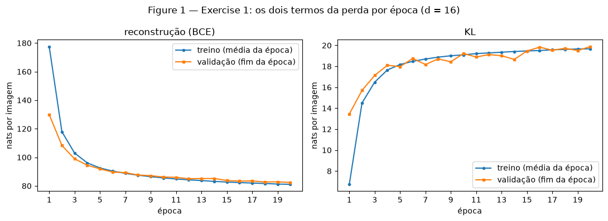
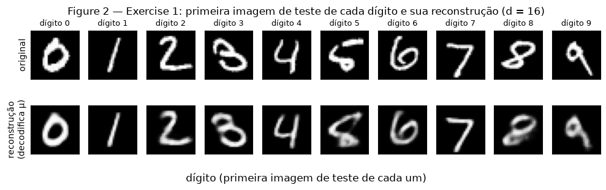
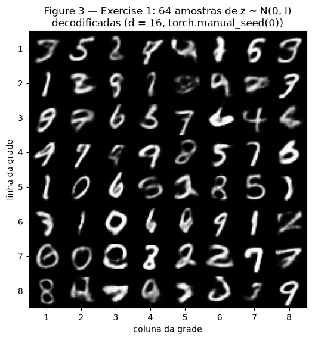
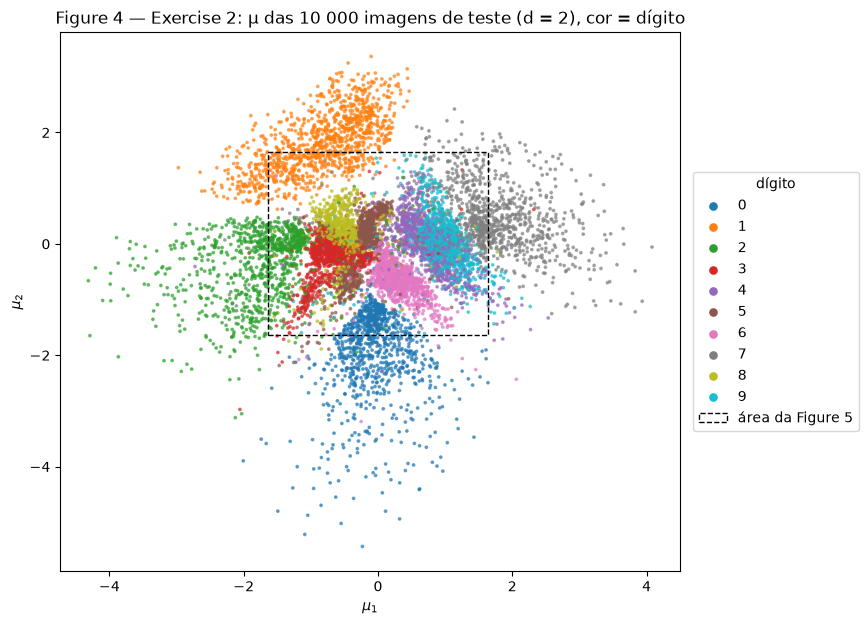
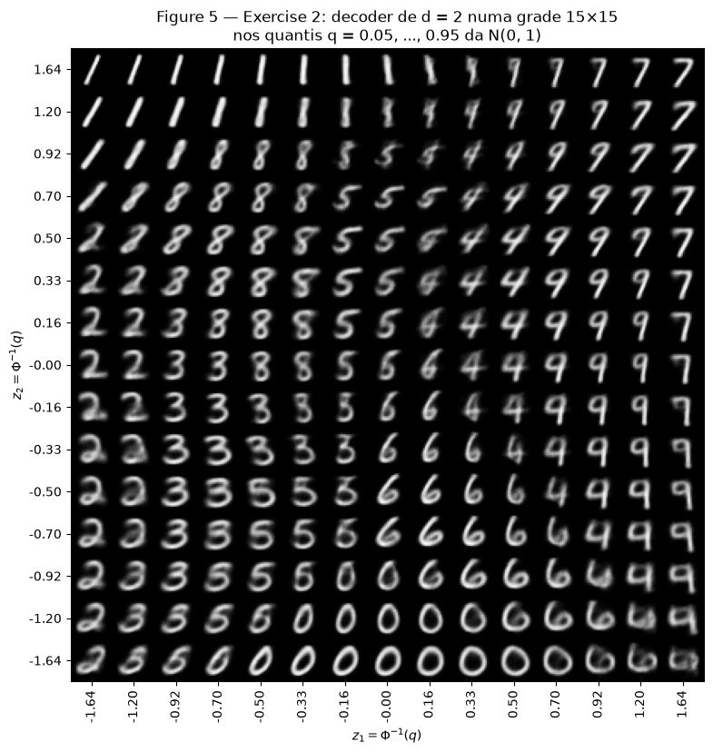
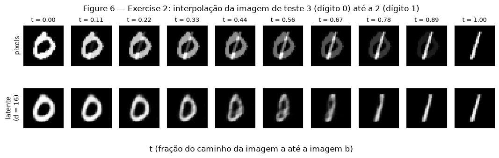

# Exercise 4 — VAE

Neste exercício treinei um VAE no MNIST. No Exercise 1 o espaço latente tem $d = 16$ dimensões, e acompanho os
dois termos da perda separadamente. No Exercise 2 o mesmo modelo tem $d = 2$, o que permite desenhar o espaço
latente e medir o custo dessa redução.

**Como fiz.**

- O VAE está em [`code/vae.py`](code/vae.py): encoder, as duas cabeças ($\boldsymbol{\mu}$ e
  $\log \boldsymbol{\sigma}^2$) e decoder com a arquitetura do enunciado. O autograd do PyTorch calcula os
  gradientes. A reparametrização, os dois termos da perda e a amostragem da prior foram escritos à mão, sem
  classe de VAE pronta e sem `torch.distributions`.
- Todos os valores estão em **nats por imagem**: soma nos 784 pixels (ou nas $d$ dimensões) e média nas imagens.
- Treino com Adam ($10^{-3}$), lote 128 e 20 épocas. Chamo `torch.manual_seed(42)` antes de construir cada
  modelo. A validação é medida ao fim de cada época. O teste só é usado depois do treino, para os números finais.
- Na validação e no teste, $z$ é sorteado de $q(z \mid x)$, uma amostra por imagem. Esse sorteio usa um gerador
  próprio com seed fixa, para que medir a validação não altere o treino.
- Em algumas análises usei um classificador de dígitos auxiliar ([`code/digit_judge.py`](code/digit_judge.py)):
  uma rede 784 → 256 → 10 treinada no conjunto de treino, com 96.89% de acurácia na validação. Ele não faz parte
  do VAE. Uso a confiança dele para medir se uma imagem gerada é reconhecível como dígito, como no laboratório
  da Aula 17.
- Fixei `torch.set_num_threads(4)`. Rodei os scripts do zero mais de uma vez, em pastas diferentes, e também o
  notebook. Os números foram iguais em todas as execuções. Cada treino de 20 épocas levou cerca de 3.5 minutos.

O notebook com todas as saídas está em [`code/vae_notebook.ipynb`](code/vae_notebook.ipynb).

```python
--8<-- "docs/exercises/vae/code/vae.py"
```

```python
--8<-- "docs/exercises/vae/code/digit_judge.py"
```

---

## Exercise 1

**A VAE on MNIST.** Script do exercício:

```python
--8<-- "docs/exercises/vae/code/ex1_mnist.py"
```

### A — Load and split the data

Carreguei o MNIST do torchvision com `transforms.ToTensor()` e fiz o `random_split` como no enunciado: 50 000
imagens de treino e 10 000 de validação, com `torch.Generator().manual_seed(42)`. As 10 000 imagens oficiais de
teste formam o conjunto de teste. Cada imagem vira um vetor de 784 pixels em $[0, 1]$.

Para não converter as imagens a cada época, guardo os três conjuntos como tensores. Uso os índices escolhidos
pelo `random_split` e divido o `uint8` por 255, que é a conta do `ToTensor()`. O código confere que o resultado
é igual ao do `ToTensor()`.

### B — Build the model

| parte | camadas |
|---|---|
| encoder | $784 \to 512 \to 256$, ReLU depois de cada uma |
| cabeças | duas lineares $256 \to 16$: uma para $\boldsymbol{\mu}$, outra para $\log \boldsymbol{\sigma}^2$ |
| decoder | $16 \to 256 \to 512 \to 784$, ReLU nas ocultas e sigmoide na saída |

O modelo tem 1 079 600 parâmetros. As partes específicas do VAE, em `vae.py`:

- **Reparametrização:** $\mathbf{z} = \boldsymbol{\mu} + \boldsymbol{\sigma} \odot \boldsymbol{\varepsilon}$, com
  $\boldsymbol{\varepsilon} \sim \mathcal{N}(0, I)$ e $\boldsymbol{\sigma} = \exp(\tfrac12 \log \boldsymbol{\sigma}^2)$.
  O sorteio fica em $\boldsymbol{\varepsilon}$, que não depende dos parâmetros. Assim o gradiente passa por
  $\boldsymbol{\mu}$ e $\boldsymbol{\sigma}$ até o encoder.
- **Reconstrução:** BCE somada nos 784 pixels, que é $-\log p(\mathbf{x} \mid \mathbf{z})$ com cada pixel
  Bernoulli. Uso `F.binary_cross_entropy(..., reduction="sum")` e divido pelo tamanho do lote. Com
  `reduction="mean"` a BCE seria dividida também por 784, o que equivale a $\beta \approx 784$.
- **KL em forma fechada:** $\tfrac12 \sum_{i=1}^{d} (\mu_i^2 + \sigma_i^2 - 1 - \log \sigma_i^2)$.
- **Perda:** reconstrução $+\ \beta \cdot$ KL, com $\beta = 1$, na média das imagens do lote.
- **Amostragem:** $\mathbf{z} \sim \mathcal{N}(0, I)$ com `torch.randn`, seguido do decoder.

### C — Train

Treinei 20 épocas com Adam ($10^{-3}$) e lote 128, registrando os dois termos no treino (média da época) e na
validação (fim da época).

**Resultado no teste:** reconstrução **81.77**, KL **19.94** e $-$ELBO **101.72** nats por imagem, próximo da
referência do enunciado (cerca de 81 e 20). Na validação, o KL foi **13.44** na primeira época e **19.88** na
última, e a reconstrução foi de 129.94 para 82.39.



Na primeira época, a curva de treino fica acima da de validação na reconstrução (177.50 contra 129.94) e abaixo
no KL (6.73 contra 13.44). Isso ocorre porque o valor de treino é a média da época, que inclui o início do
treino, e a validação é medida no fim da época. A partir da época 5 as curvas ficam próximas. Na época 20 a
reconstrução foi 81.09 no treino e 82.39 na validação, então não há sinal de overfitting.

### D — Reconstructions and samples



Linha de cima: a primeira imagem de teste de cada dígito (índices 3, 2, 1, 18, 4, 8, 11, 0, 61 e 7, para os
dígitos de 0 a 9). Linha de baixo: a reconstrução decodificando $\boldsymbol{\mu}$, sem sortear $z$.



A Figure 3 tem 64 imagens decodificadas de $\mathbf{z} \sim \mathcal{N}(0, I)$, sorteadas depois de
`torch.manual_seed(0)`.

### E — Analysis

**Por que o KL sobe no começo enquanto a perda total cai?** Antes do treino, o KL de validação era 0.03 e a
reconstrução era 544.71. Com os pesos iniciais, $\boldsymbol{\mu} \approx 0$ e $\boldsymbol{\sigma} \approx 1$,
então $q(z \mid x)$ é quase igual à prior para qualquer imagem. Nesse caso $z$ não contém informação sobre a
imagem, e o decoder não consegue reconstruí-la. Para reduzir a reconstrução, o encoder precisa afastar
$\boldsymbol{\mu}$ de zero e reduzir $\boldsymbol{\sigma}$, o que aumenta o KL. No início, a queda da
reconstrução é muito maior que o aumento do KL:

- do início até a época 4, o KL subiu 18.07 nats (de 0.03 para 18.10) e a reconstrução caiu 450.22 (de 544.71
  para 94.49);
- da época 1 para a época 4, o KL subiu 4.66 e a reconstrução caiu 35.45, cerca de 7.6 nats de reconstrução
  para cada nat de KL.

Como o otimizador minimiza a soma dos dois termos, aumentar o KL reduz a perda total. Depois da época 4 o KL
quase não sobe (de 18.10 para 19.88 em 16 épocas), enquanto a reconstrução ainda cai 12.10 nats.

**Por que a Figure 3 é pior que a Figure 2?**

1. **Onde as amostras da prior caem.** Na Figure 2, $z$ é o $\boldsymbol{\mu}$ de uma imagem real e está numa
   região em que o decoder foi treinado. Na Figure 3, $z$ vem de $\mathcal{N}(0, I)$, e o KL não garante que os
   códigos das imagens reais cubram toda a prior. Ficam regiões sem códigos de imagens reais, os "buracos" do
   espaço latente da Aula 17, onde o decoder não foi treinado. Para medir isso, usei as 11 dimensões ativas
   (as outras 5 têm KL praticamente zero e não carregam informação) e calculei a distância de cada ponto até o
   $\boldsymbol{\mu}$ mais próximo de 5 000 imagens de validação. Para códigos de outras 5 000 imagens de
   validação, a distância mediana foi 1.47. Para as 64 amostras da Figure 3, foi 1.83.
   23 das 64 amostras ficaram acima do quantil de 95% dos códigos reais (seriam cerca de 3 se as amostras
   caíssem onde caem os códigos reais). O classificador auxiliar confia menos nessas amostras: confiança média
   de 0.73 nelas e 0.85 nas outras 41, contra 0.91 nas reconstruções da
   Figure 2.
2. **O que o decoder devolve para um $z$.** O decoder devolve a probabilidade de cada pixel estar aceso, e a
   saída que minimiza a perda é a média das imagens compatíveis com aquele $z$ (Aula 17). Uma média de imagens
   é borrada. A fração de pixels cinza (entre 0.1 e 0.9) é 9.2% nas imagens originais da Figure 2, 17.8% nas
   reconstruções e 16.5% nas amostras da Figure 3. O borrão, portanto, aparece nas duas figuras. A diferença está
   em quais imagens são compatíveis com $z$. O $\boldsymbol{\mu}$ de uma imagem real corresponde a imagens
   parecidas com ela, e a média continua sendo aquele dígito. Um $z$ da prior entre códigos de dígitos
   diferentes é compatível com imagens de vários dígitos, e a média mistura os traços deles, como nas posições
   (2, 2) e (8, 2) da Figure 3. Por isso aparecem formas que não são dígitos, mesmo sem mais pixels cinza.

**Por que decodificar $\boldsymbol{\mu}$ e não um $z$ sorteado na Figure 2?** $\boldsymbol{\mu}$ é o centro de
$q(z \mid x)$, o código mais provável da imagem. Um $z$ sorteado é $\boldsymbol{\mu}$ mais um ruído de desvio
$\boldsymbol{\sigma}$, e esse ruído é grande: na validação, o $\sigma$ médio foi 0.440 e o $|\mu|$ médio foi
0.555. Com $z$ sorteado, cada execução daria uma reconstrução diferente, e a figura mostraria o ruído do sorteio
além da qualidade do modelo. Com $\boldsymbol{\mu}$ a reconstrução é determinística e melhor: 77.42 nats na
validação, contra 82.39 com $z$ sorteado.

---

## Exercise 2

**A Latent Space You Can See.** Script do exercício:

```python
--8<-- "docs/exercises/vae/code/ex2_latent2d.py"
```

### A — Train a 2-D VAE

Treinei o mesmo modelo mudando só $d = 2$: mesmos dados, seed, $\beta = 1$ e orçamento de treino (20 épocas,
Adam $10^{-3}$, lote 128).

| modelo | reconstrução no teste | KL no teste | $-$ELBO no teste |
|---|---|---|---|
| $d = 16$ (Exercise 1) | 81.77 | 19.94 | 101.72 |
| $d = 2$ | **133.29** | **6.75** | 140.04 |
| diferença ($d = 2$ menos $d = 16$) | +51.52 | −13.20 | +38.32 |

Os valores de $d = 2$ estão próximos da referência do enunciado (cerca de 135 e 7). Na validação, o KL de
$d = 2$ foi de 4.83 na primeira época para 6.74 na última.

### B — The encoded test set



A Figure 4 mostra $\boldsymbol{\mu}$ das 10 000 imagens de teste, com uma cor por dígito. Os pontos foram
desenhados em ordem aleatória, para que nenhum dígito fique escondido sob outro. O quadrado tracejado é a área
coberta pela Figure 5.

### C — The decoded plane



Decodifiquei uma grade de $15 \times 15$ pontos com $z_1$ e $z_2$ iguais a $\Phi^{-1}(q)$, para 15 valores de
$q$ igualmente espaçados em $[0.05, 0.95]$ (de −1.64 a 1.64). Na figura, $z_1$ cresce da esquerda para a direita
e $z_2$ de baixo para cima, como na Figure 4.

**Por que esse espaçamento:** como $q$ é a probabilidade acumulada da $\mathcal{N}(0, 1)$ e os valores de $q$
são igualmente espaçados, entre dois pontos vizinhos da grade há sempre a mesma massa da prior
($0.9/14 \approx 0.064$ em cada eixo) e, como a prior é independente nos dois eixos, cada célula recebe a mesma
massa da prior.

### D — Interpolation

Escolhi as imagens de teste de índice **3** (um 0) e **2** (um 1), as primeiras desses dígitos no teste.



Os 10 valores de $t$ vão de 0 a 1. A linha de cima interpola os pixels,
$(1 - t)\,\mathbf{x}_a + t\,\mathbf{x}_b$. A linha de baixo interpola os códigos do modelo $d = 16$ do
Exercise 1 e decodifica, $(1 - t)\,\boldsymbol{\mu}_a + t\,\boldsymbol{\mu}_b$.

### E — Analysis

**Quais dígitos se sobrepõem na Figure 4?** O 4 e o 9 formam quase uma única nuvem, à direita do centro: as
medianas de $\boldsymbol{\mu}$ são (0.74, 0.00) e (0.94, 0.03), a 0.2 de distância. No centro, o 3, o 5 e o 8
também se misturam. Para medir isso, usei um classificador de 15 vizinhos no plano latente, ajustado com os
$\boldsymbol{\mu}$ do treino e aplicado no teste. Ele acertou 83.19%, e os pares mais confundidos foram 4 e 9
(608 erros nos dois sentidos), 3 e 8 (172), 5 e 8 (172), 7 e 9 (116) e 3 e 5 (100).

Na Figure 5, a transição do 4 para o 9 está no lado direito. Na linha $z_2 = 0.50$, o classificador auxiliar
reconhece as células de $z_1 = 0.33$ a $0.70$ como 4 e a de $z_1 = 0.92$ como 9. As imagens intermediárias são
um 4 com a parte de cima cada vez mais fechada, que pode ser lido como 4 ou como 9. Algumas têm traços mais
fracos, como uma sobreposição dos dois dígitos. O 3, o 5 e o 8 dividem o centro da grade da mesma forma: na
linha $z_2 = 0.00$, indo do 5 para a esquerda, as imagens passam a um 8 e depois a um 3.

**O que $d = 2$ perde.** Com dois números por imagem, o modelo guarda 6.75 nats de informação sobre cada
imagem, contra 19.94 com $d = 16$. Esses dois números codificam principalmente qual é o dígito, além de
inclinação e espessura. O restante do estilo (forma dos traços, voltas e detalhes de cada escrita) é perdido. A
Figure 5 mostra isso: o plano contém uma versão média de cada dígito, que varia apenas em inclinação e largura,
e nenhuma célula mostra um estilo diferente. Duas medidas na validação, decodificando $\boldsymbol{\mu}$,
confirmam isso:

- a variação dentro de cada dígito (distância média de cada imagem até a média do seu dígito) nas
  reconstruções é 72.9% da variação das imagens originais com $d = 16$ e 34.5% com $d = 2$;
- o classificador auxiliar reconhece o dígito correto em 95.84% das reconstruções com $d = 16$ e em 82.79% com
  $d = 2$. Nos dígitos que se sobrepõem, $d = 2$ perde também a identidade do dígito.

Por isso a reconstrução é 51.52 nats pior.

**As duas linhas da Figure 6.** A linha latente passa por imagens que parecem dígitos: é uma única forma que se
transforma, com o 0 ficando mais estreito e alongado até virar um 1. Os quadros de $t = 0.44$ e $0.56$ são os
menos claros, uma forma oval e estreita entre o 0 e o 1, mas ainda formada por um único traço. A linha de
pixels não passa por dígitos: ela mostra um 0 e um 1 sobrepostos, cada um com parte do brilho. Nos quadros do
meio cerca de 24% dos pixels são cinza, contra 9.4% no 0 original. A média de duas imagens de dígitos em
geral não é a imagem de um dígito. No espaço latente, cada imagem é uma gaussiana, e a sobreposição dessas
gaussianas preenche o espaço entre os exemplos de treino (Aula 17). Por isso o segmento entre
$\boldsymbol{\mu}_a$ e $\boldsymbol{\mu}_b$ passa por códigos que o decoder transforma em imagens plausíveis.

Repeti a comparação nos 45 pares formados pelas imagens da Figure 2. Nos quadros do meio, a linha de pixels
teve 23.1% de pixels cinza e a latente 20.2%, e a latente teve menos pixels cinza em 39 dos 45 pares. A
diferença é pequena porque o decoder também gera pixels cinza (20.3% no quadro latente de $t = 0.44$). O
classificador auxiliar deu a mesma confiança média às duas linhas (0.81), porque classifica a sobreposição pelo
dígito mais forte no quadro. Por isso ele não mede bem essa diferença.

---

## Results summary

| # | Quantity | Value |
| --- | --- | --- |
| 1 | Ex. 1 — test reconstruction, KL and negative ELBO ($d = 16$) | reconstrução 81.77; KL 19.94; $-$ELBO 101.72 nats por imagem |
| 2 | Ex. 1 — validation KL at the first and at the last epoch | 13.44 (época 1) e 19.88 (época 20) |
| 3 | Ex. 2 — test reconstruction and KL ($d = 2$) | reconstrução 133.29; KL 6.75 nats por imagem ($d = 16$: 81.77 e 19.94) |
| 4 | Ex. 2 — the two test indices interpolated | 3 (dígito 0) e 2 (dígito 1) |
